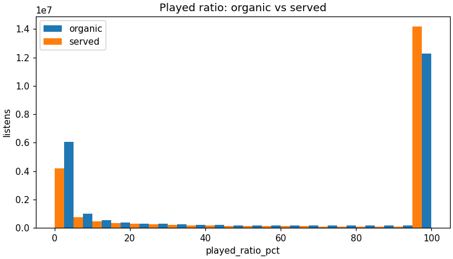
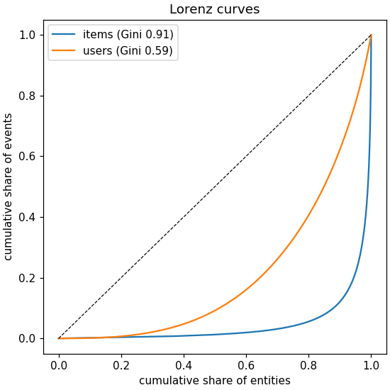
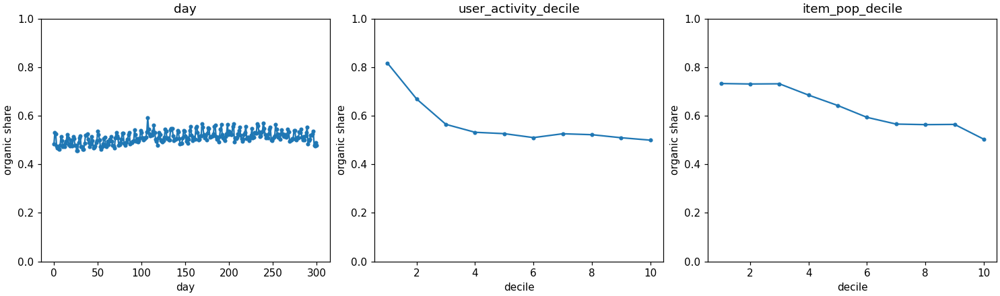
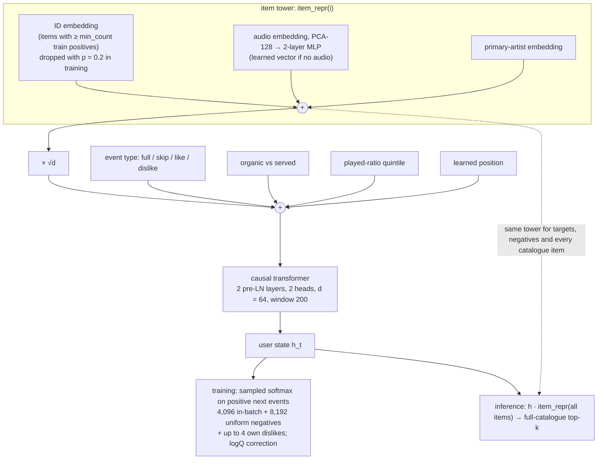

# HookSeq: next-track recommendation on Yambda with audio, feedback-type and exposure signals

## Abstract

HookSeq is a SASRec-style causal transformer for next-track recommendation, trained and
evaluated on the Yambda dataset under its official Global Temporal Split with full-catalogue
ranking. It adds three kinds of signal a music service already logs: audio embeddings and the
artist in the item representation, so that tracks without interaction history can be scored;
the event type (full listen, skip, like, dislike) and played-ratio bucket of each history
event; and whether the user chose the track (organic) or a recommender served it. Training
uses a sampled softmax with logQ correction and the user's own dislikes as hard negatives. We
first reproduce the paper's SASRec on Yambda-50M within 3.1% of its NDCG@10 (0.0771 vs
0.0748), then build a stronger SASRec baseline (0.0970) and measure HookSeq against that. On
Yambda-500M, HookSeq reaches NDCG@10 0.1009 against 0.0798 for our SASRec and 0.0754 for the
paper's. The paired per-user difference is +0.0211 (95% CI [+0.0198, +0.0223]) and Recall@100
improves by +0.0483 [+0.0467, +0.0499]. The ablations do not support the motivating story,
and we report them as they are. Audio and artist features *lower* warm accuracy at 50M
(−0.0107 NDCG@10). Most of the gain comes from two sources. The first is logQ correction
(+0.0149 at 50M). The second is the training setup of the ablation base: all events as
context, random windows, a ≥ 5-positive ID table and ID dropout. That setup is +0.0104 over
our SASRec, but the comparison is unpaired and the four changes are confounded. The
event-type, organic and played-ratio tokens add +0.0035, and the best 50M model has no content
features at all. Content features give non-zero but very
small scores on never-seen tracks: NDCG@10 0.0003 and Recall@100 0.0089 at 500M, against
exactly 0 for every ID-only model. HookSeq also concentrates artist exposure more than SASRec
does. Everything ran on Kaggle's free tier, about 14.8 GPU-hours for the reported runs.

**Contents.** [1 Introduction](#1-introduction-and-motivation) ·
[2 Related work](#2-related-work) · [3 Data and EDA](#3-data-and-eda) ·
[4 Evaluation protocol](#4-evaluation-protocol) · [5 Method](#5-method) ·
[6 Experiments, in order](#6-experiments-in-chronological-order) · [7 Results](#7-results) ·
[8 Discussion](#8-discussion) · [9 Threats to validity](#9-threats-to-validity-and-limitations) ·
[10 Shipping at Hook](#10-how-it-would-ship-at-hook) · [11 Reproduce](#11-reproduce-on-kaggle) ·
[12 Demo](#12-demo) · [13 Future work](#13-future-work) · [References](#references)

Companion documents: the full generated results in [reports/results.md](reports/results.md),
the decision log in [docs/decisions.md](docs/decisions.md) (cited below as D1–D26), the EDA
write-up in [reports/eda_summary.md](reports/eda_summary.md), the run procedure in
[docs/kaggle_runbook.md](docs/kaggle_runbook.md), and the original design spec in
[docs/superpowers/specs/2026-11-12-hookseq-design.md](docs/superpowers/specs/2026-11-12-hookseq-design.md).

### Headline results (Yambda-500M, test day, Listen+ truth, 45,921 warm users)

| model | NDCG@10 | NDCG@100 | Recall@10 | Recall@100 | Recall_paper@10 | Recall_paper@100 | Coverage@10 |
|---|---|---|---|---|---|---|---|
| **HookSeq (a8)** | **0.1009** | **0.1322** | **0.0980** | **0.1909** | **0.0591** | **0.1892** | 0.0236 |
| SASRec (ours, strong) | 0.0798 | 0.1005 | 0.0769 | 0.1426 | 0.0489 | 0.1416 | 0.0488 |
| iALS (ours) | 0.0392 | 0.0677 | 0.0401 | 0.1136 | 0.0181 | 0.1123 | 0.0052 |
| DecayPop (ours) | 0.0263 | 0.0365 | 0.0276 | 0.0587 | 0.0150 | 0.0582 | 0.0000 |
| MostPop (ours) | 0.0161 | 0.0223 | 0.0153 | 0.0349 | 0.0068 | 0.0345 | 0.0000 |
| SASRec (paper) | 0.0754 | 0.0884 | – | – | 0.0336 | 0.1240 | 0.0347 |
| ItemKNN (paper) | 0.0708 | 0.0771 | – | – | 0.0320 | 0.1049 | 0.0257 |
| BPR (paper) | 0.0400 | 0.0652 | – | – | 0.0137 | 0.0861 | 0.0244 |
| iALS (paper) | 0.0384 | 0.0621 | – | – | 0.0131 | 0.0811 | 0.0022 |
| DecayPop (paper) | 0.0267 | 0.0340 | – | – | 0.0127 | 0.0505 | 0.0000 |
| MostPop (paper) | 0.0173 | 0.0237 | – | – | 0.0060 | 0.0309 | 0.0000 |

HookSeq − SASRec, paired bootstrap over users: **NDCG@10 +0.0211 [+0.0198, +0.0223]**,
**Recall@100 +0.0483 [+0.0467, +0.0499]**. `Recall@k` is the official Yambda definition,
hits@k / min(|T|, k). The paper's Recall column corresponds to `Recall_paper@k` = hits@k / |T|
(§4, D6), so compare paper recall against that column only. Paper rows are from the Yambda
paper's Table 6 [1]. Source: [reports/results.md](reports/results.md), generated from
`results/*.json`.

On Yambda-50M (4,597 warm users) the reproduction row is SASRec (paper setting, BCE) 0.0771
vs the paper's 0.0748. Our strong SASRec gets 0.0970, the nominal HookSeq configuration (a4)
0.1163, and the best model, a7 (no content features), 0.1207. Full tables are in §7.

---

## 1 Introduction and motivation

Hook is a music platform built around remixing and an Explore feed, so its core
recommendation question is "what should play next for this listener, in this session?".
Sequential recommenders such as SASRec [2] answer exactly that question. In their standard
form, though, they see only item IDs and a single kind of positive interaction. A production
music service logs more than that, and this project asks whether three of those extra signals
improve a strong SASRec under a protocol that is comparable with published numbers.

1. **Content for a growing catalogue.** New releases and newly licensed tracks have no
   interaction history, so an ID-only model cannot rank them at all. Pre-computed audio
   embeddings and the artist give such items a representation [9, 10].
2. **Typed feedback.** A skip, a like and a dislike say different things about a listener.
   Positive-only models drop the negatives entirely.
3. **Exposure.** Yambda marks every event as organic (the user found the track) or served (a
   recommender put it in front of them). In a feedback loop, a model trained on served
   events learns partly from its predecessor's choices [11].

We also report artist-exposure concentration next to accuracy, because an artist-first
platform cares about who gets recommended as well as about the hit rate.

**Contributions.** (i) A faithful reproduction of Yambda's evaluation protocol and baselines
from the official benchmark code: the popularity baselines and iALS are within 7% of the paper
at both sizes, and SASRec at 50M is within 3.1% (§6). (ii) HookSeq and a cumulative ablation
ladder, with two follow-up controls that separate "content features help" from "the ID
vocabulary threshold costs accuracy" (§6.6–6.7). (iii) A 500M comparison against a deliberately
strong SASRec, with paired confidence intervals, slices and exposure metrics (§7). (iv) A
resumable, free-tier Kaggle pipeline with every reported number traceable to a run record
(§11).

**Success criteria of the design spec (§1), and where each is met.**

| # | criterion | status |
|---|---|---|
| 1 | Reproduced SASRec within ~15% of the paper's 50M NDCG@10 | Met: 0.0771 vs 0.0748, +3.1% (§6.5) |
| 2 | HookSeq beats SASRec on NDCG@10 and Recall@100 on at least one size, ideally 500M | Met at both sizes, against the strong SASRec (§7.2) |
| 3 | An ablation table reported honestly, including additions that do not help | Met: a0–a4 plus a7/a8; audio hurts warm accuracy (§6.6–6.7). The stretch steps a5/a6 were not run |
| 4 | EDA findings visibly drive preprocessing | Met (§3) |
| 5 | Tests pass; README with a results table and "Why this matters for Hook"; the Gradio demo runs | Met: 432 tests pass, and the demo is live on Hugging Face Spaces (§12) |

### Why this matters for Hook

| Hook reality | What HookSeq uses | What we actually found |
|---|---|---|
| Remixing and Explore are session-driven ("what next?") | A causal transformer over each listener's recent events | +26% relative NDCG@10 over a strong SASRec at 500M (0.1009 vs 0.0798), significant under a paired bootstrap |
| Hook's feed shapes what users see (feedback loops) | An organic/served flag on every input event; organic and served slices in evaluation | The relative gain is largest on served truth: 0.0336 vs 0.0189 NDCG@10 at 500M (+78%), against 0.1239 vs 0.1046 on organic truth (+18%; the absolute gain is larger there). The flag's own effect was not isolated (it entered together with event type and played ratio). |
| The catalogue keeps growing (new deals, new artists) | Audio embedding and artist in the item representation, with ID dropout | Content makes never-seen tracks scorable (ID-only models score exactly 0), but only barely: NDCG@10 0.0003 and Recall@100 0.0089 at 500M. **Not a solved problem.** |
| Artist-first positioning | Artist-exposure Gini, artist coverage and long-tail share next to accuracy | HookSeq concentrates exposure *more* than SASRec: artist Gini@10 0.9927 vs 0.9845, long-tail share@10 0.017 vs 0.042. That is a real cost for an artist-first product. |
| Likes, skips and dislikes say more than plays | Event-type and played-ratio inputs; dislikes as hard negatives | Event, organic and ratio inputs together: +0.0035 NDCG@10 at 50M. Dislike negatives: +0.0012, which is within noise. |

## 2 Related work

**Yambda** [1] is a public music-streaming log from Yandex, with listens (and their played
ratio), likes, dislikes, an organic flag and CNN audio embeddings. It is released in 50M, 500M
and 5B-event subsets, together with a benchmark: the Global Temporal Split, full-catalogue
ranking, and MostPop, DecayPop, ItemKNN, iALS, BPR, SANSA and SASRec baselines. We use its
protocol and its Table 6 (the Listen+ setting) as our reference.

**Sequential recommendation.** SASRec [2] applies causal self-attention to item sequences. It
was originally trained with a binary cross-entropy loss and one sampled negative per position.
Later work showed that a softmax cross-entropy over many negatives improves SASRec
substantially [5], and that the BCE-with-few-negatives setting makes it overconfident [6].
This is why our strong SASRec baseline uses a sampled softmax (D7).

**Sampled softmax and popularity bias.** In-batch negatives are sampled in proportion to
popularity. Without correction this penalises popular items. The logQ correction [3]
subtracts the log sampling probability from the logits, and mixing in uniform negatives [4]
covers the tail.

**Content and cold start.** Content-based music recommendation from audio goes back to deep
models of audio features [9]. DropoutNet [10] trains with input dropout on the preference
(ID) component so that the content path learns to stand on its own. Our ID dropout follows
that idea.

**Feedback loops and exposure.** Recommenders trained on their own outputs homogenise
consumption [11], and popularity bias in recommendation lists can be measured and re-ranked
for [12]. We report exposure metrics but do not intervene on them.

**Evaluation.** We rank the full catalogue rather than a sampled candidate set, because
sampled metrics can reorder models [13]. The iALS baseline follows [7, 8].

## 3 Data and EDA

**Data.** Yambda `flat/50m` and `flat/500m` multi-event logs [1], the artist mapping and the
audio embeddings filtered to each subset's items. At 50M the raw log has 47,790,449 events.
Cleaning (reconciling unlike/undislike with the event they cancel, de-duplicating, dropping bad
listens) leaves 46,771,197 events from 9,999 users over 886,174 items. At 500M the raw log has
480,255,564 events and 2,638,024 subset items with an audio embedding (K0 log). The processed
bundle has 99,994 users, 2,838,520 items and 467,298,567 train events, of which 291,020,237
are Listen+ (K2 log). Every EDA statistic below is from 50M (K1;
[reports/eda_stats.json](reports/eda_stats.json)).

Every preprocessing threshold in `configs/data_*.yaml` points to an EDA finding. Three findings
did most of the work:

<p align="center">



</p>

*Left: the played ratio is bimodal. Middle: item popularity is extremely concentrated.
Right: the organic share falls with user activity and with item popularity.*

| EDA finding (section of [eda_summary.md](reports/eda_summary.md)) | Decision (config key) |
|---|---|
| §2 The played ratio is bimodal. The 95–100% bin holds 63.3% of served and 52.2% of organic listens, the 0–5% bin 18.8% and 25.9%, and each middle bin at most 1–4%. | `full_threshold: 50`. A listen at ≥ 50% is Listen+ (the paper's definition), and Listen+ is the ground truth (D4) |
| §1 Item Gini 0.907. The top 1% of items take 49.2% of events, the top 10% take 87.9%, and the tail exponent is α ≈ 1.49. Roughly 3×10⁵ of 886K items have ≥ 5 events. | `min_count: 5` for an ID embedding, about a third of the catalogue (D13). logQ correction for the popularity-skewed in-batch negatives (D10) |
| §3 Log inter-event gaps have spikes at 5 and 10 s (artefacts of the 5-second timestamp grid) and a mode at one track length. The automatic valley detector returns 15.9 s. | `session_gap_seconds: 1800`. The 15.9 s value is rejected as a grid artefact |
| §4 71.1% of listens are re-listens, but only 2.0% repeat the immediately preceding item | `collapse_consecutive_dups: false`. No filtering of seen items at evaluation |
| §5 About half of events are organic (daily mean 51.1%). The share falls from 81.7% in the least active user decile to 50–53%, and from 73% for the least popular items to 50% for the most popular | `model.use_organic`. Organic and served truth slices |
| §6 A median of 2,346 new items per day after warm-up. The Jaccard distance between consecutive days' top-100 has a median of 0.40 | Temporal split. A DecayPop half-life grid down to sub-day windows (D5) |
| §7 Events per user: median 2,594, 99th percentile 23,752, maximum 27,647 | `model.max_len: 200` (the official SASRec value). Histories stored uncapped at 50M and capped at 1,024 events at 500M (D13) |
| §8 Audio coverage is 90.4–96.5% across popularity deciles, and the embedding map shows artist structure | `model.use_audio`, `use_artist`, a learned missing-audio vector, `pca_dim: 128` |
| §9 The like rate rises with played ratio up to 27.6% at 80–90%. The dislike rate is about 1.0–1.3% | Dislikes as hard negatives. Likes kept out of the truth |
| §10 3.0% of distinct test items (any event type) have no train event, carrying 1.2% of test events. Over distinct test-*truth* items (Listen+ items of warm users, the denominator used by the evaluation slices) the share is 2.2% at 50M and 1.3% at 500M (`new_items_share.meta`) | Keep them as misses. Report a `new_items` slice (D14, D17) |

One threshold rests on an approximation. The `min_count` evidence counts events of any type
over the whole log, while the threshold counts train positives. A planned exact statistic
(`items_with_ge_k_positives`) was never produced because K1 was not rerun. Ablation a8 tests
the threshold directly (§6.7).

## 4 Evaluation protocol

We follow the official benchmark code (shipped in the Hugging Face repo `yandex/yambda`). Where
it disagrees with the paper text, we follow the code (D2, D6).

- **Split.** The official test day starts at 25,913,600 s (= 26,000,000 − 86,400). Train is
  everything before the test start minus a 30-minute gap. Validation mirrors this one day
  earlier. Timestamps are in seconds (D2).
- **Users and truth.** The truth for a user is the set of items with a Listen+ event on the
  test day. Users need at least one Listen+ train event (the warm users). Cold test users
  (1 at 50M, 8 at 500M) are scored separately with a MostPop fallback (D3).
- **Ranking.** Each model ranks the full catalogue (886,174 items at 50M, 2,838,520 at 500M).
  Seen items are not filtered. User state is frozen at the test start.
- **Metrics.** NDCG@k (binary gains, IDCG over min(|T|, k)), `Recall@k` = hits@k / min(|T|, k)
  (official), `Recall_paper@k` = hits@k / |T| (much closer to the paper's tables, though not
  equal to them; see §6.4), and
  Coverage@k = distinct recommended items / catalogue size, for k ∈ {10, 100}.
- **Slices.** `organic` / `served` truth items; `warm_items` (with a data-vocabulary ID);
  `idless_items` (fewer than 5 train positives); `new_items` (no train event of any kind, a
  subset of `idless_items` that only content can score); user-activity terciles.
- **Exposure.** Artist-exposure Gini over all artists, artist coverage, and long-tail share,
  which is the share of recommendations outside the top 20% of items by train popularity.
- **Statistics.** A bootstrap over users (1,000 resamples, 95% percentile interval) for each
  run, and a paired bootstrap of per-user differences for HookSeq vs SASRec (D21). Training
  randomness (one seed per configuration) is not covered (§9).
- **Model selection.** Every neural model except `sasrec_bce` is early-stopped on validation
  NDCG@10 and refit on the full training period for the selected number of steps (D9).
  `sasrec_bce` trains a fixed 3,500 steps in both passes, as the official recipe does. Baselines pick their
  hyperparameters on validation.

## 5 Method



**Backbone.** HookSeq subclasses our SASRec. It is a causal transformer encoder with
d = 64, 2 pre-LN layers, 2 heads, a 4d GELU feed-forward layer, dropout 0.2, learned positions
over a 200-event window, √d-scaled item embeddings and a final LayerNorm. The input and output
item representations are shared. The user state is the encoder output at the last position,
and each item is scored by a dot product with its representation
([src/hookrec/models/sasrec.py](src/hookrec/models/sasrec.py)).

**Item tower** ([src/hookrec/models/hookseq.py](src/hookrec/models/hookseq.py)). The item
representation is `ID_emb·keep + MLP(audio) + artist_emb`. The ID embedding exists only for
items with at least `min_count` train positives (5 by default, 1 in a8). During training, the
ID is zeroed with probability 0.2, without rescaling. Items without audio use a learned
vector. Audio is the Yambda CNN embedding, PCA-reduced to 128 dimensions, with the PCA fit on
items that have a train event. Because the tower is used for inputs, targets, negatives and
scoring, a track with no ID still gets a full-catalogue score from its audio and artist. With
every flag off the model has exactly SASRec's parameter set, which a unit test checks.

**Input tokens.** Each history event adds embeddings of its event type, its organic flag and
its played-ratio quintile to the item representation and position. HookSeq reads every event
type, so skips and dislikes are context. It is trained to predict the next *positive* event
(Listen+ or like) at each position.

**Loss** ([src/hookrec/models/losses.py](src/hookrec/models/losses.py)). Each batch shares one
negative set of 4,096 items drawn with replacement from the batch's targets plus 8,192 uniform
items. With logQ on, the positive logit and each sampled-negative logit are reduced by the log
of that item's expected count in the sampled set (the hard negatives are not),
computed from positive-event popularity of the training period in use [3, 4]. With
dislike negatives on, each row adds up to 4 of its most recent disliked items. Accidental hits
are masked. The loss is a custom chunked kernel: fp16 matmuls, fp32 softmax statistics, and
the full logit matrix is never materialised (D11).

**Training.** Batch 256, AdamW with learning rate 1e-3 and weight decay 0.01 (not on
embeddings, biases or norms), 1,000 warmup steps then cosine, gradient clipping at 1.0, fp16
AMP on one T4, and seed 42. Each epoch draws one window per user, with the window start
weighted towards recent history. Validation runs every 500 steps with a patience of 6
evaluations, and the test refit uses the selected step count (D9).

**Baselines.** MostPop; DecayPop with the half-life chosen on validation (0.82 days at 50M,
0.27 days at 500M); iALS [7, 8] (`implicit`, chosen on validation: 128 factors, α = 1,
regularisation 0.01, 15 iterations). All three are fit on full-period Listen+ aggregates (D5).
There are two SASRec rows (D7):

| | `sasrec_bce` (paper setting) | `sasrec` (strong baseline) | `a0_sasrec` (ablation base) |
|---|---|---|---|
| architecture | official: post-LN, input LayerNorm, no √d, no final LN | pre-LN, √d, final LN | same as `sasrec` |
| loss | BCE, 1 uniform negative per position | sampled softmax, 4,096 in-batch + 8,192 uniform, no logQ | same as `sasrec` |
| optimiser | Adam, constant 1e-3, no clipping, fp32, 3,500 steps (≈100 epochs) | AdamW, warmup + cosine, clip 1.0, fp16, early stopping | same as `sasrec` |
| dropout | 0.0 | 0.2 | 0.2 (+ ID dropout 0.2) |
| input | Listen+ only, one last window per user | Listen+ only, one last window per user | all event types, random windows |
| ID table | every catalogue item | every catalogue item | items with ≥ 5 train positives |

## 6 Experiments, in chronological order

Each phase records (a) what we tried, (b) what we expected, (c) what happened, (d) how we
interpret it, marked **[evidence]** when a run or test supports it and **[hypothesis]** when
it does not, and (e) the decision that followed. Commits are pinned by tag (D22).

### 6.1 Building against the official benchmark code (protocol fidelity)

(a) We implemented the split, the metrics and the truth from the plan, then read the official
benchmark code (`benchmarks/yambda/processing/timesplit.py`, `constants.py`,
`evaluation/metrics.py`). (b) We expected small differences in wording. (c) There were three
substantive ones. The test day is anchored at the last timestamp, with the gap carved from
the train side, not from the test day. Raw timestamps are seconds on a 5-second grid, not
5-second units, so the plan's day length was wrong by a factor of 5. And the official
benchmark keeps only test users seen in train. (d) **[evidence]** Each one would have produced
an off-protocol split. (e) We rewrote the split to the official definition and anchor, and
made warm users the headline population (D2, D3).

### 6.2 EDA (K1, 50M)

(a) We ran ten analyses, each tied to a decision (§3). (b) We expected a "positive listen"
threshold near 50% and a session gap near 30 minutes. (c) The threshold held: the distribution
is bimodal. The automatic session-gap detector returned 15.9 s. (d) **[evidence]** 15.9 s is the
valley between the 5-second-grid spikes and the track-length mode, not a session boundary.
(e) We kept 1,800 s and set every threshold of §3 (D13).

### 6.3 Pre-flight audit before any real run

(a) We reviewed the whole pipeline against the paper's setting before spending compute.
(b) We expected minor issues. (c) Five issues would each have skewed the headline. The truth
included likes, while the paper uses Listen+ only. The baselines were fit on truncated
stored histories, not on the full period. SASRec read every event type, while the official
one reads Listen+ only. The logQ popularity was computed from different sources in the val
and test passes. And stale processed bundles could be silently reused. (d) **[evidence]** Each issue is
a deviation from the official code, confirmed by reading it. (e) We made the truth Listen+
only, fit the baselines on full-period aggregates, gave `sasrec` Listen+ input with one last
window per user, took the logQ popularity from the period in use, hashed a pipeline version
into the bundle name, and aligned the DecayPop grid with the official one (D4, D5, D8, D10,
D22).

### 6.4 Baselines as a protocol check (K3, 50M then 500M)

(a) We ran MostPop, DecayPop and iALS before any neural model. They have no training
randomness that could hide a protocol error. (b) We expected them within ~15% of the paper,
the project's gate. (c) NDCG@10 was within 7% at both sizes:

| | MostPop | DecayPop | iALS |
|---|---|---|---|
| 50M ours / paper | 0.0177 / 0.0186 (−4.8%) | 0.0256 / 0.0260 (−1.5%) | 0.0379 / 0.0407 (−6.9%) |
| 500M ours / paper | 0.0161 / 0.0173 (−6.9%) | 0.0263 / 0.0267 (−1.5%) | 0.0392 / 0.0384 (+2.1%) |

Recall did not agree. With the official definition, our recall was 2.0–3.1× the paper's at
k = 10 and 1.12–1.46× at k = 100. This holds over the 50M and 500M baselines, 50M `sasrec_bce`
and 500M `sasrec` against the paper's SASRec. (d) **[evidence]** NDCG agreement validates the
split, the truth and the users. **[hypothesis, strong]** Most of the recall gap is a
definitional change. The official `metrics.py` divides by min(|T|, k), but the repo carries a
later commit "Fix yet another bug in metrics (#24)" and a leftover comment implying the old
denominator was |T|. With hits/|T| (`Recall_paper@k`) the gap shrinks, but it does not close.
Where both are available (the 500M baselines and 50M `sasrec_bce`), our values sit 12–38%
above the paper's. For example, 500M MostPop has a `Recall@10` of 0.0153 and a
`Recall_paper@10` of 0.0068, against the paper's 0.0060, and 500M iALS has a `Recall_paper@10`
of 0.0181 against 0.0131 while its NDCG@10 is within 2.1%. That remaining gap is unexplained. (e) We report both definitions
and compare paper recall only against `Recall_paper@k` (D6).

### 6.5 SASRec: a throughput problem, then a faithful and a strong baseline (K4, 50M)

(a) The first SASRec run used a sampled softmax. (b) We expected to land within ~15% of the
paper's 0.0748. (c) Two things went wrong. First, it trained far too slowly to afford the
ablation ladder, let alone 500M. A profiling notebook attributed most of the step time to the
fp32 sampled-softmax loss and its backward pass, not to data loading. Second, it landed far
*above* the paper. That record (at tag v0.2-r2) was superseded and is not in `results/`; the
rerun at v0.3 gives 0.0970, +29.7%. (d) **[evidence]** The baselines match the paper, so the
protocol is not the cause. **[hypothesis, supported by the literature]** The official SASRec
uses BCE with one negative, and softmax over many negatives is known to be much stronger
[5, 6]. (e) We made two decisions. We rewrote the loss as a chunked fp16 kernel that computes
the same values, which after the change ran at 6.0 steps/s for SASRec and 7.0–9.4 steps/s for
HookSeq-path runs on one T4 (D11). And we split SASRec into two rows (D7). `sasrec_bce`
mirrors the official recipe line by line: architecture, BCE with negatives from the Listen+
catalogue, Adam at a constant learning rate, about 100 epochs, and scoring restricted to the
Listen+ catalogue that the official evaluation ranks. It scores **0.0771 vs 0.0748 (+3.1%)**,
which meets success criterion 1. `sasrec`, at 0.0970, is the bar HookSeq has to clear.

This bundle of differences between the two rows (loss, architecture, optimiser, dropout) was
not ablated, so the +0.0199 gap between them is not attributed to the loss alone.

### 6.6 The ablation ladder (K4, 50M, one session)

(a) We ran a0 → a4, each adding one group to the previous configuration (D16). (b) The design
expected content features to cost little on warm items and to pay off on cold items, and logQ
to help. (c) Results, test NDCG@10 and Recall@100, with Δ against a0:

| run | adds | NDCG@10 | Δ | Recall@100 | Δ | 95% CI (NDCG@10) |
|---|---|---|---|---|---|---|
| a0_sasrec | HookSeq path, every flag off | 0.1074 | – | 0.1823 | – | [0.1023, 0.1132] |
| a1_audio | + audio, artist | 0.0967 | −0.0107 | 0.1626 | −0.0197 | [0.0914, 0.1023] |
| a2_audio_event_organic | + event type, organic, played ratio | 0.1002 | −0.0072 | 0.1657 | −0.0166 | [0.0950, 0.1054] |
| a3_full_logq | + logQ correction | 0.1151 | +0.0077 | 0.2016 | +0.0193 | [0.1095, 0.1210] |
| a4_full_dislike | + dislike hard negatives (= `hookseq.yaml`) | 0.1163 | +0.0089 | 0.2001 | +0.0178 | [0.1106, 0.1225] |

(d) **[evidence]** Content features hurt warm accuracy (−10% relative), event-type, organic and
ratio inputs recover part of the loss (+0.0035), and logQ is the largest single step (+0.0149
over a2). The dislike step (+0.0012) lies well inside the intervals. a4 beats `sasrec` by
+0.0192 [+0.0152, +0.0232] (paired) and a0 by +0.0089 [+0.0052, +0.0127]. **[evidence]** Content
features also raised the long-tail share of the top-10 from 0.062 (a0) to 0.148 (a1), and logQ
cut it to 0.049 (a3). **[hypothesis]** a1's warm loss has two candidate causes. The content
path might be harmful in itself, or the cost might come from the `min_count` threshold: the
1–4-positive tail has no ID, so those items must be represented by content alone, while
SASRec has an ID for every item. The ladder cannot tell these apart. (e) We added two
controls (§6.7).

### 6.7 Slice audit and the follow-up controls a7, a8 (K4 + K5, 50M)

(a) The first 50M evaluation report had a `cold_items` slice, on which SASRec (0.0184 NDCG@10)
beat every audio model (0.0061–0.0098). On inspection the slice meant "no HookSeq ID", and
SASRec has an ID row for every item, so it was not a cold-start slice. We renamed it
`idless_items` and added `new_items`, the truth items with no train event of any kind (D17).
We then ran a7 (the full model minus audio and artist) and a8 (the full model with an ID for
every item with ≥ 1 train positive), both on the same processed bundle (D18). (b) If content
helps the full model, a7 should fall below a4. If the threshold is the cost, a8 should rise
above a4. (c) Results:

| run | NDCG@10 (val) | NDCG@10 (test) | Recall@100 | `idless_items` NDCG@10 | `new_items` NDCG@10 / Recall@100 |
|---|---|---|---|---|---|
| sasrec | 0.0979 | 0.0970 | 0.1551 | 0.0184 | 0 / 0 |
| a4_full_dislike | 0.1166 | 0.1163 | 0.2001 | 0.0066 | 0.0039 / 0.0312 |
| a7_full_no_content | **0.1215** | **0.1207** | **0.2085** | 0 | 0 / 0 |
| a8_full_all_ids | 0.1168 | 0.1184 | 0.2046 | 0.0146 | 0.0012 / 0.0188 |

The 475 users with a `new_items` truth item get exactly zero from every ID-only model (a0, a7,
both SASRec rows, every baseline). The content models get small non-zero scores: a1
0.0037 / 0.0577, a2 0.0047 / 0.0480, a3 0.0034 / 0.0213, a4 0.0039 / 0.0312, a8
0.0012 / 0.0188 (NDCG@10 / Recall@100). (d) **[evidence]** On warm accuracy the content features
do not help the full model: a7 is the best model on validation and test, +0.0044 over a4. On
`new_items`, content is the only path that works at all. Its Recall@100 of 0.0577 (a1) is far
above a uniformly random ranking, which would give 100 / 886,174 ≈ 1.1×10⁻⁴, yet it is small in
absolute terms. **[evidence]** a8 recovers part of a4's `idless_items` loss (0.0146 vs 0.0066) but
lowers its `new_items` scores (NDCG@10 0.0012 vs 0.0039, Recall@100 0.0188 vs 0.0312). **[hypothesis]** A full ID table lets the model lean on IDs and
train the content path less, and logQ, which shrinks `new_items` Recall@100 from 0.048 (a2) to
0.021 (a3), pushes rankings towards the popular head where new tracks are absent. Neither
mechanism was tested. a7 and a8 are not significantly different from each other at 50M (their
unpaired CIs [0.1148, 0.1266] and [0.1129, 0.1246] overlap almost entirely). (e) We had to
choose one HookSeq configuration for 500M (§6.8).

### 6.8 Scaling to 500M (K0–K5)

(a) Preprocessing 500M needed per-user sharding and a 1,024-event cap on stored histories. It
peaked at 13,091 MB RSS in a 14 GB session and took 47 minutes (K2 log). The budget allowed
one HookSeq run besides `sasrec`. We chose **a8 over the validation-best a7** (D19): a7 cannot
score a never-seen track at all, which is the Hook motivation, and a8 still beat `sasrec` by
+0.0214 [+0.0175, +0.0252] at 50M. (b) We expected the 50M ordering to hold and the content
path to matter more on a larger, newer catalogue. (c) The first a8 version crashed with CUDA
out-of-memory at its first periodic evaluation. The process held 11.47 GiB of the T4's
14.56 GiB, and the top-k tie check asked for 3.82 GiB more. Rerun with an evaluation batch of
256 instead of 1,024 (an operational setting, outside the training hash), it completed (D20).
Final numbers: a8 val 0.1018, test **0.1009**; `sasrec` val 0.0809, test **0.0798** (the paper
gives 0.0754, so +5.8%). The paired difference is +0.0211 [+0.0198, +0.0223]. The 500M
baselines again matched the paper (§6.4). On the slices, a8 scores 0.0003 NDCG@10 and 0.0089
Recall@100 on `new_items` (2,006 users), and `sasrec` beats a8 on `idless_items`
(0.0273 vs 0.0139). (d) **[evidence]** The accuracy result transfers, at +26% relative. The
content path at 500M is near-useless for never-seen tracks. **[hypotheses]** §8. (e) We report
it as it is, and note it as the first item of future work.

### 6.9 Compute used

| stage | GPU-h (from `extra.gpu_hours`) |
|---|---|
| 50M `sasrec` + `sasrec_bce` | 0.41 + 0.21 |
| 50M ablation ladder a0–a4 | 3.58 |
| 50M a7 + a8 | 1.83 |
| 500M `sasrec` | 5.08 |
| 500M a8 | 3.15 (+ 0.12 h of session for the out-of-memory attempt) |
| 500M scoring (K5) | 0.38 (session wall time) |
| **total** | **≈ 14.8** of a planned 20 |

The superseded first SASRec run and two profiling sessions are not counted, because their
records are not kept. Per-run details are in [docs/kaggle_runbook.md §6](docs/kaggle_runbook.md#6-gpu-budget-spec-section-9a).

## 7 Results

All numbers are on the test day, from [reports/results.md](reports/results.md).

### 7.1 Headline

500M is shown at the top of this page. At 50M:

| model | NDCG@10 [95% CI] | NDCG@100 | Recall@100 [95% CI] | Recall_paper@100 | Coverage@10 |
|---|---|---|---|---|---|
| a7_full_no_content (best) | 0.1207 [0.1148, 0.1266] | 0.1487 | 0.2085 [0.2013, 0.2162] | 0.2068 | 0.0224 |
| a8_full_all_ids | 0.1184 [0.1129, 0.1246] | 0.1452 | 0.2046 [0.1975, 0.2120] | 0.2029 | 0.0248 |
| a4_full_dislike (`hookseq.yaml`) | 0.1163 [0.1106, 0.1225] | 0.1436 | 0.2001 [0.1932, 0.2077] | 0.1983 | 0.0244 |
| sasrec (strong) | 0.0970 [0.0915, 0.1025] | 0.1132 | 0.1551 [0.1484, 0.1615] | 0.1541 | 0.0341 |
| sasrec_bce (paper setting) | 0.0771 [0.0725, 0.0812] | 0.0909 | 0.1211 [0.1157, 0.1264] | 0.1200 | 0.0094 |
| iALS | 0.0379 [0.0350, 0.0408] | 0.0696 | 0.1179 [0.1131, 0.1228] | – | 0.0083 |
| DecayPop | 0.0256 [0.0235, 0.0281] | 0.0350 | 0.0565 [0.0530, 0.0606] | – | 0.0000 |
| MostPop | 0.0177 [0.0157, 0.0198] | 0.0231 | 0.0359 [0.0333, 0.0388] | – | 0.0000 |
| SASRec (paper) | 0.0748 | 0.0764 | – | 0.1026 | 0.0130 |

The 50M baseline records predate `recall_paper@k` (they ran at tag v0.2-r2). The CIs come from
the evaluation re-scoring, which agrees with the training records to within 7×10⁻⁵ on every
metric. That can flip a fourth decimal, as in a3 (0.1151 vs 0.1152) and 500M iALS (0.0392 vs
0.0393).

### 7.2 Paired differences (per-user bootstrap)

| size | comparison | ΔNDCG@10 [95% CI] | ΔRecall@100 [95% CI] |
|---|---|---|---|
| 500M | a8 − sasrec | **+0.0211 [+0.0198, +0.0223]** | **+0.0483 [+0.0467, +0.0499]** |
| 50M | a4 − sasrec | +0.0192 [+0.0152, +0.0232] | +0.0450 [+0.0398, +0.0501] |
| 50M | a7 − sasrec | +0.0236 [+0.0196, +0.0277] | +0.0533 [+0.0483, +0.0583] |
| 50M | a8 − sasrec | +0.0214 [+0.0175, +0.0252] | +0.0494 [+0.0446, +0.0546] |
| 50M | a4 − a0 | +0.0089 [+0.0052, +0.0127] | +0.0178 [+0.0129, +0.0228] |
| 50M | a7 − a0 | +0.0133 [+0.0099, +0.0167] | +0.0261 [+0.0216, +0.0305] |
| 50M | a8 − a0 | +0.0110 [+0.0075, +0.0144] | +0.0222 [+0.0173, +0.0269] |

At 500M no HookSeq variant other than a8 was trained, so there is no 500M ablation.

### 7.3 Slices (NDCG@10; Recall@100 for `new_items`)

| slice | 500M a8 | 500M sasrec | 50M a4 | 50M a7 | 50M a8 | 50M sasrec |
|---|---|---|---|---|---|---|
| all | 0.1009 | 0.0798 | 0.1163 | 0.1207 | 0.1184 | 0.0970 |
| organic truth | 0.1239 | 0.1046 | 0.1479 | 0.1578 | 0.1541 | 0.1317 |
| served truth | 0.0336 | 0.0189 | 0.0281 | 0.0252 | 0.0258 | 0.0142 |
| warm_items | 0.1007 | 0.0791 | 0.1163 | 0.1221 | 0.1178 | 0.0960 |
| idless_items | 0.0139 | **0.0273** | 0.0066 | 0 | 0.0146 | **0.0184** |
| new_items NDCG@10 | 0.0003 | 0 | 0.0039 | 0 | 0.0012 | 0 |
| new_items Recall@100 | 0.0089 | 0 | 0.0312 | 0 | 0.0188 | 0 |
| users, low activity | 0.1089 | 0.0877 | 0.1271 | 0.1352 | 0.1344 | 0.1095 |
| users, mid activity | 0.0952 | 0.0754 | 0.1121 | 0.1113 | 0.1081 | 0.0908 |
| users, high activity | 0.0987 | 0.0764 | 0.1096 | 0.1155 | 0.1128 | 0.0908 |

Slice users at 500M: organic 31,907, served 28,491, idless 4,852, new 2,006. At 50M: organic
3,236, served 2,858, idless 1,270, new 475. HookSeq leads SASRec in every activity tercile. Its
relative gain is largest on served truth (+78% at 500M, against +18% on organic truth).
**[hypothesis]** Served items sit in the popular head (EDA §5), and logQ, the largest
ablation step, moves served-truth NDCG@10 from 0.0205 (a2) to 0.0273 (a3) at 50M, so the
served gain is plausibly a popularity-calibration effect rather than an effect of the organic
flag.

### 7.4 Exposure

| run | artist Gini@10 | artist coverage@10 | long-tail share@10 | Coverage@10 |
|---|---|---|---|---|
| 500M a8 | 0.9927 | 0.0394 | 0.0170 | 0.0236 |
| 500M sasrec | 0.9845 | 0.0686 | 0.0416 | 0.0488 |
| 500M iALS | 0.9976 | 0.0127 | 0.0000 | 0.0052 |
| 50M a0 | 0.9723 | 0.0700 | 0.0622 | 0.0319 |
| 50M a1 (+content) | 0.9723 | 0.0688 | 0.1480 | 0.0351 |
| 50M a2 (+event/organic/ratio) | 0.9724 | 0.0685 | 0.1436 | 0.0346 |
| 50M a3 (+logQ) | 0.9820 | 0.0521 | 0.0490 | 0.0233 |
| 50M a4 (+dislikes, `hookseq.yaml`) | 0.9811 | 0.0544 | 0.0572 | 0.0244 |
| 50M a7 | 0.9818 | 0.0534 | 0.0289 | 0.0224 |
| 50M a8 | 0.9808 | 0.0555 | 0.0608 | 0.0248 |
| 50M sasrec | 0.9701 | 0.0742 | 0.1029 | 0.0341 |
| 50M sasrec_bce | 0.9943 | 0.0270 | 0.0091 | 0.0094 |

**[evidence]** The step that buys the most accuracy, logQ, is also the step that concentrates
exposure: a2 → a3 raises the artist Gini@10 from 0.9724 to 0.9820 and cuts the long-tail share
from 0.144 to 0.049. At 500M HookSeq recommends from fewer artists and fewer tail items than
SASRec does.

## 8 Discussion

**What drives the gain over SASRec.** The ladder isolates only part of the gain.
**[evidence]** logQ correction is a single-factor step, worth +0.0149 NDCG@10 at 50M (a2 → a3).
The event-type, organic and played-ratio tokens add +0.0035 (a1 → a2), and dislike negatives
add +0.0012, which is within noise. **[evidence, confounded]** The training setup of the
ablation base a0 is +0.0104 over `sasrec` (unpaired). That gap bundles four changes, none of
which was separated from the others: all event types as context instead of Listen+ only,
random windows instead of one last window, an ID table restricted to items with ≥ 5 train
positives, and ID dropout of 0.2. Audio and artist features do not add warm accuracy, and the
best 50M model drops them (a7).
**[hypothesis]** Two things may explain why logQ helps so much here. Item popularity is extremely
concentrated (item Gini 0.907), so in-batch negatives, which are popularity-sampled, penalise
the head heavily unless they are corrected [3]. And the Listen+ truth is itself head-heavy.
**[hypothesis]** Within the a0 setup, context events may help because skips and dislikes tell
the model what a user rejected, and random windows may help because they show it many more
distinct training contexts than one last window per user. These four sub-factors of the a0
setup were not ablated on their own.

**Why audio did not deliver on new tracks at 500M.** The measured facts are these. At 500M a8
scores 0.0003 NDCG@10 and 0.0089 Recall@100 on 2,006 `new_items` users, roughly half of its
50M Recall@100 (0.0188). At 50M every content model was weak on this slice, and the strongest
on Recall@100 were the two models without logQ (a1 0.0577, a2 0.0480). Candidate explanations, none of them
tested:
1. **Catalogue size.** At 500M a content-only vector competes with 2,838,520 items instead of
   886,174.
2. **a8's ID table.** At 50M, giving every item an ID (a8) cut `new_items` Recall@100 from
   0.0312 (a4) to 0.0188. If the model leans on IDs, the content path receives less training
   signal as a stand-alone representation, and an ID dropout of 0.2 may be too weak to force
   it.
3. **logQ.** logQ shifts rankings towards the popular head (§7.4), where never-seen tracks
   are absent by definition.
4. **Slice composition.** At 500M the `new_items` slice is a superset of the truly unseen items
   (1.55% of distinct test-truth items by the slice definition vs 1.29% by the preprocessing
   count), because
   1,024-event stored histories hide some old non-positive events. The extra items have train
   events but no train positive, so a8 has no ID for them either, and they are scored from
   content just like the truly new ones.

The project therefore does **not** show that audio solves cold start. It shows that content
makes never-seen tracks rankable, at a level far above random but far below warm items.

**The exposure trade-off.** HookSeq's accuracy comes with more concentrated artist exposure. At
50M the mechanism is visible in the ablation (logQ). At 500M the net effect is clear: artist
coverage@10 0.0394 vs 0.0686, long-tail share 0.017 vs 0.042. For an artist-first platform this
trade-off has to be managed explicitly, for example with partial logQ (`loss.mix_uniform`),
exposure-aware re-ranking [12] or a tail-exposure constraint. None of these was tried.

**`idless_items`.** SASRec beats every HookSeq variant on items with fewer than 5 train
positives, never-seen items included, at both sizes (500M: 0.0273 vs 0.0139). This holds
even though a8 has an ID for every such item with 1–4 positives. **[hypothesis]**
ID dropout and the added content vector dilute the ID signal of rarely seen items, and SASRec's
plain ID rows fit them more directly. This was not tested.

## 9 Threats to validity and limitations

- **One seed per configuration.** The CIs cover user sampling, not training randomness.
  Differences between neighbouring ablation steps that lie within the CIs (a3 vs a4, a7 vs a8)
  should be read as ties.
- **No hyperparameter tuning** beyond early stopping (D24). All transformer rows share the
  official SASRec sizes (d = 64, 2 layers) and learning rate. The cosine horizon (200,000
  steps) is far longer than any run trained, so the learning rate decays only slightly. Tuning
  could change every neural row, including `sasrec`.
- **Test reuse in one decision.** The choice of a8 for 500M (D19) used 50M *test* results
  (`new_items`, `idless_items`). The two sizes share the official test day
  (the same `test_timestamp`) and plausibly users, although we did not verify that the 50M users
  are a subset of the 500M users. The 500M margin (+0.0211) is large relative to its
  CI, but the choice itself was not blind.
- **Confounded comparisons.** `sasrec_bce` vs `sasrec` differ in loss, architecture, optimiser
  and dropout, and `sasrec` vs a0 differ in input filter, window sampling, ID table and ID
  dropout. Neither gap is attributed to a single factor. The ladder is cumulative, not
  factorial, so order effects are not identified.
- **Mixed code versions.** The 50M baselines ran at v0.2-r2, the SASRec rows at v0.3, a0–a4
  at v0.3.1, and a7, a8 and every 500M run at v0.4. All 50M rows share one processed bundle,
  and every evaluation record was re-scored at v0.4 with a drift check against the training
  record.
- **Paper comparisons are cross-implementation.** We matched the official code where we could
  read it, but our scoring ranks the full vocabulary for every row except `sasrec_bce` (masked
  to the Listen+ catalogue, as in the official evaluation), and the recall definition is
  ambiguous (D6).
- **500M details.** Stored histories are capped at 1,024 events, so the neural models'
  windows are unaffected but the `new_items` slice is a superset (§8). Only one HookSeq
  configuration ran.
- **Tiny cold-user sets** (n = 1 and n = 8). Those rows are not interpretable.
- **The `min_count` evidence is approximate** (§3).
- **Offline only.** A temporal hold-out of logged data cannot measure what a recommender does to
  the feedback loop it sits in. The organic/served slices describe the logging policy, not
  ours.

## 10 How it would ship at Hook

HookSeq would be a candidate generator, not the final ranker:
1. Precompute `item_repr` for the whole catalogue, including tracks that went live today (audio
   and artist only), into an ANN index. Compute the user state online from the session's last
   200 events.
2. Retrieve a few hundred candidates by dot product, then re-rank with a ranker that sees
   context, freshness and business rules, including an explicit artist-exposure and
   new-release quota (§8 shows that the retriever alone will not provide one).
3. Validate offline on Hook's logs with this temporal protocol, then run an online A/B test
   with listen-through, likes, skips and artist-level exposure as guardrail metrics.
4. Log organic vs served and the serving policy's propensities, so that later models can
   correct for their own feedback loop instead of learning it.

## 11 Reproduce on Kaggle

Every number comes from six headless Kaggle notebooks (`notebooks/kaggle/k0…k5`), pinned to the
tag **v0.4** of this repository. The step-by-step procedure, inputs, resume logic and
troubleshooting table are in [docs/kaggle_runbook.md](docs/kaggle_runbook.md).

| step | notebook | accelerator | what it does |
|---|---|---|---|
| K0 | `k0_download` | CPU | download Yambda 50M/500M, filter the embeddings to the subset |
| K1 | `k1_eda` | CPU | the EDA figures and `eda_stats.json` (50M) |
| K2 | `k2_preprocess` | CPU | clean, label, split, vocabulary, features, packed sequences, aggregates |
| K3 | `k3_baselines` | CPU | MostPop, DecayPop, iALS: validation grid, then test refit |
| K4 | `k4_train` | GPU T4 | the val pass, then the test refit of each config in `CONFIGS` |
| K5 | `k5_eval_report` | CPU at 50M, GPU at 500M | re-scoring, slices, exposure, CIs, `reports/results.md` |

Settings for the reported runs: `CONFIGS` lists `configs/sasrec.yaml`,
`configs/sasrec_bce.yaml`, `configs/ablations/a0…a4`, `a7`, `a8`. At 500M, a8 needs
`OVERRIDES = ["train.eval_batch_size=256"]`.

Locally (CPU, synthetic data only):

```bash
uv venv .venv --python 3.12 && uv pip install --python .venv -e ".[dev,torch]"
.venv/bin/pytest -q          # 432 tests on a synthetic Yambda-shaped fixture
.venv/bin/ruff check .
# rebuild the results tables from the committed run records (per-user .npz files, which the
# paired section needs, are git-ignored and come from the K5 outputs)
.venv/bin/python -c "from hookrec.eval.report import write_readme_tables; write_readme_tables('results', 'reports/results.md')"
```

Each record in `results/` stores the resolved config, its hash, the git SHA, the processed-bundle
name, the training steps, the step rate and the GPU hours.

## 12 Demo

**Live:** [huggingface.co/spaces/Arush1050/musicreccmodel](https://huggingface.co/spaces/Arush1050/musicreccmodel)
(Gradio 6.31.0 on ZeroGPU). It was verified by a `gradio_client` call on 2026-11-14 (recorded
in [docs/hf_space.md](docs/hf_space.md)). Loading a sample user returned its 20 session rows,
and Recommend then returned HookSeq's and SASRec's top-5 side by side. The Space runs
the code of the reported runs, tag `v0.1-demo`, which is the same commit as `v0.4`. The bundle
was exported in a Kaggle CPU notebook from the **500M test checkpoints** of a8 (HookSeq) and
`sasrec`. It holds a 56,120-item subset of the catalogue and 200 sample users, 57.1 MB in all
(export log), and it lives in the Space's `bundle/` directory next to `app.py`. There is no
screenshot or GIF.

The app ([src/hookrec/demo/app.py](src/hookrec/demo/app.py)) has two tabs:
- **Session → next tracks.** Load a sample user, or build a session of tracks with event type
  and organic/served flags, then compare HookSeq's top-k with SASRec's side by side. Each
  recommended track shows its artist and popularity. Editing the event or organic flags shows
  how HookSeq's typed inputs move its ranking; SASRec reads only full listens.
- **New-track audience.** Pick a track with no ID (scored from audio and artist only) and see
  the sample users HookSeq ranks it highest for. This tab **demonstrates the mechanism**, not
  cold-start accuracy. On the 500M `new_items` slice the same model scores NDCG@10 0.0003 and
  Recall@100 0.0089 (§7.3, §8).

Track and artist IDs are Yambda's anonymised integers, because the dataset has no titles.
Recommendations are restricted to the bundle's item subset. To export a bundle and run it
locally, see [docs/hf_space.md](docs/hf_space.md):

```bash
python scripts/export_demo.py --processed PROCESSED_DIR \
    --hookseq-ckpt ckpt/a8_full_all_ids/test/model_final.pt \
    --sasrec-ckpt ckpt/sasrec/test/model_final.pt --out bundle/
pip install -e ".[demo]" && python -m hookrec.demo.app --bundle bundle/
```

## 13 Future work

In priority order, with the evidence each item would address:
1. **Make the content path earn its keep on new tracks.** Try a higher ID dropout, a
   content-only auxiliary loss, or no logQ on the content tower, and evaluate a4- and a1-style
   models at 500M on `new_items` (§8).
2. **Exposure-aware training or re-ranking:** partial logQ (`loss.mix_uniform`), a tail-exposure
   constraint, or an artist-diversity re-ranker, measured on the exposure table (§7.4).
3. **Disentangle the confounds:** a7 at 500M; single-factor runs for input filter vs window
   sampling (a0 vs `sasrec`), and for loss vs architecture (`sasrec` vs `sasrec_bce`).
4. **Seeds and tuning:** 3 seeds for the headline rows, and a small learning-rate and width sweep
   for both `sasrec` and HookSeq.
5. **The stretch features** already implemented but not run: a multi-task like head (a5) and a
   time-gap embedding (a6).
6. Out of scope by design (spec §13): a second-stage GBDT ranker, real-time serving, bandit
   exploration, raw-audio processing.

## References

1. Yambda-5B: A Large-Scale Multi-modal Dataset for Ranking and Retrieval. arXiv:2505.22238
   (v2), 2025. Dataset and benchmark code: huggingface.co/datasets/yandex/yambda.
2. W.-C. Kang, J. McAuley. Self-Attentive Sequential Recommendation. ICDM 2018.
3. X. Yi, J. Yang, L. Hong, D. Z. Cheng, L. Heldt, A. Kumthekar, Z. Zhao, L. Wei, E. Chi.
   Sampling-Bias-Corrected Neural Modeling for Large Corpus Item Recommendations. RecSys 2019.
4. J. Yang, X. Yi, D. Z. Cheng, L. Hong, Y. Li, S. Wang, T. Xu, E. H. Chi. Mixed Negative
   Sampling for Learning Two-tower Neural Networks in Recommendations. WWW 2020 (Companion).
5. A. Klenitskiy, A. Vasilev. Turning Dross Into Gold Loss: is BERT4Rec really better than
   SASRec? RecSys 2023.
6. A. Petrov, C. Macdonald. gSASRec: Reducing Overconfidence in Sequential Recommendation
   Trained with Negative Sampling. RecSys 2023.
7. Y. Hu, Y. Koren, C. Volinsky. Collaborative Filtering for Implicit Feedback Datasets. ICDM
   2008.
8. S. Rendle, W. Krichene, L. Zhang, Y. Koren. Revisiting the Performance of iALS on Item
   Recommendation Benchmarks. RecSys 2022.
9. A. van den Oord, S. Dieleman, B. Schrauwen. Deep Content-Based Music Recommendation.
   NeurIPS 2013.
10. M. Volkovs, G. Yu, T. Poutanen. DropoutNet: Addressing Cold Start in Recommender Systems.
    NeurIPS 2017.
11. A. J. B. Chaney, B. M. Stewart, B. E. Engelhardt. How Algorithmic Confounding in
    Recommendation Systems Increases Homogeneity and Decreases Utility. RecSys 2018.
12. H. Abdollahpouri, R. Burke, B. Mobasher. Managing Popularity Bias in Recommender Systems
    with Personalized Re-ranking. FLAIRS 2019.
13. W. Krichene, S. Rendle. On Sampled Metrics for Item Recommendation. KDD 2020.
